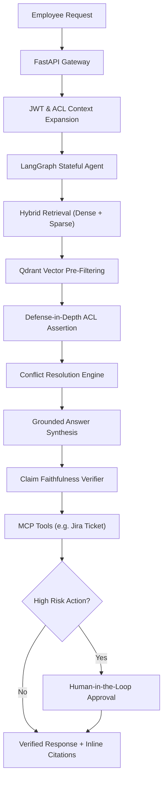

# Enterprise Knowledge Agent

> A production-grade, permission-aware, agentic RAG platform ensuring zero permission leaks across enterprise knowledge sources with stateful reasoning, citation verification, and human-in-the-loop tool execution via Model Context Protocol (MCP).

---

## Key Capabilities
- **Zero Permission Leaks**: Pre-filtering directly in vector index traversal with defense-in-depth post-retrieval assertions.
- **Autonomous Agentic Reasoning (LangGraph)**: Multi-hop intent decomposition, self-RAG evidence grading, cross-document conflict resolution, and claim verification.
- **Multi-Source Connectors**: Support for Google Drive, Notion, Confluence, Slack, Jira, PDFs, with OCR and markdown table parsing.
- **MCP Tool Integration**: Safe action execution with risk classification (`read`, `write_low`, `write_high`) and human-in-the-loop interrupts.
- **Empirical Evaluation**: RAGAS evaluation suite, golden Q&A dataset, and zero-leak permission matrix regression gates.

---

## Architecture Overview



---

## Project Structure

```
├── backend/
│   ├── app/
│   │   ├── api/                 # API endpoints (health, chat, admin, feedback)
│   │   ├── core/                # Configuration, logging, errors, security, telemetry
│   │   ├── domain/              # Entities, ACL models, conflict policies
│   │   ├── ingestion/           # Connectors, layout parsers, PII maskers
│   │   ├── retrieval/           # Hybrid search, reranking, Qdrant client
│   │   ├── governance/          # Permission assertion, audit logs, injection defense
│   │   ├── agent/               # LangGraph workflow, nodes, prompts, memory
│   │   ├── tools/               # MCP client, tool registry, approval handlers
│   │   ├── services/            # Cache, rate limiting, model routing
│   │   └── db/                  # SQLAlchemy async models, repositories
│   └── tests/                   # Unit, integration, security, e2e test suites
├── docs/                        # Architecture, STRIDE threat model, ADRs, runbooks
├── evaluation/                  # Golden QA dataset, RAGAS metrics, baseline naive RAG
├── frontend/                    # Next.js chat UI with citations and admin portal
├── mcp_servers/                 # Model Context Protocol servers
├── data/sample_corpus/          # Synthetic enterprise documents
└── docker-compose.yml           # Complete containerized local stack
```

---

## Quick Start

### Local Development Setup
```bash
# 1. Install dependencies
uv --no-config pip install --python .venv/Scripts/python.exe -e ".[dev]"

# 2. Run unit tests
.venv/Scripts/pytest backend/tests/unit

# 3. Start local backend server
.venv/Scripts/uvicorn app.main:app --app-dir backend --host 127.0.0.1 --port 8000 --reload
```

### Docker Compose
```bash
docker compose up -d
```

---

## Implementation Roadmap
- [x] **Phase 0: Foundation** (Repo scaffold, configs, structured logging, errors, CI skeleton, ADRs, tests)
- [ ] **Phase 1: Data and Ingestion** (Synthetic corpus, seed users/ACLs, connectors, parsing, chunking, PII)
- [ ] **Phase 2: Retrieval and Naive Baseline** (Naive RAG, hybrid search, rerank, ACL pre-filtering)
- [ ] **Phase 3: Governance** (JWT, RBAC, audit log, conflict resolution, injection defense, semantic cache)
- [ ] **Phase 4: Agent** (LangGraph state machine, grading loops, claim verification, streaming)
- [ ] **Phase 5: MCP Tools and Approvals** (MCP server/client, risk levels, human approval interrupt/resume)
- [ ] **Phase 6: Evaluation** (Golden set, permission matrix, RAGAS runner, benchmark report)
- [ ] **Phase 7: Frontend** (Next.js chat UI, citations panel, admin console)
- [ ] **Phase 8: Observability and Hardening** (Tracing, Prometheus/Grafana, rate limiting, load tests)
- [ ] **Phase 9: Packaging** (Documentation, runbook, demo script)
