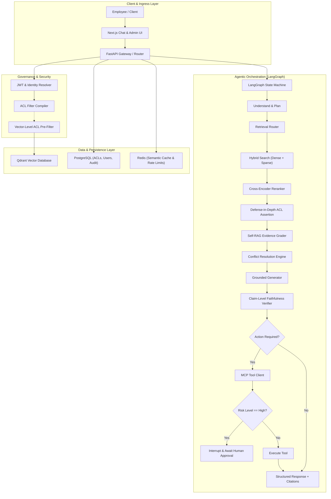
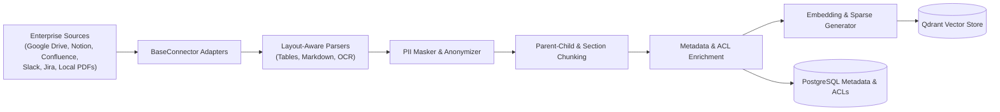
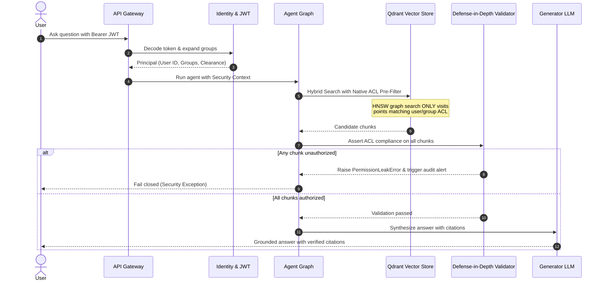

# Enterprise Knowledge Agent: System Architecture

## 1. High-Level Architecture Overview

The **Enterprise Knowledge Agent** is a multi-tenant, permission-aware agentic RAG platform designed with hexagonal (ports and adapters) principles to ensure zero-leak document access control, autonomous self-correction, claim verification, and safe tool execution through Model Context Protocol (MCP).

## 2. Ingestion Pipeline Architecture

## 3. Defense-in-Depth Permission Enforcement

