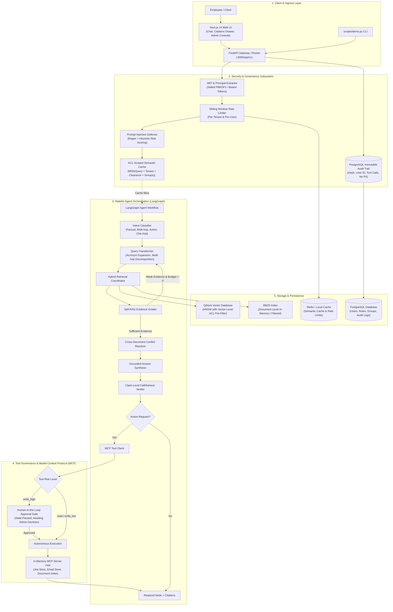
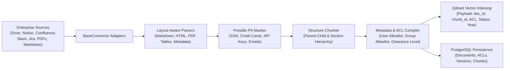
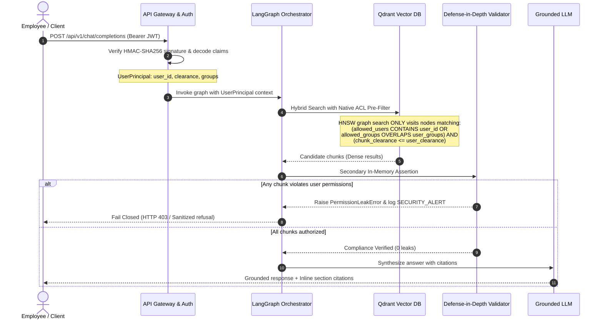
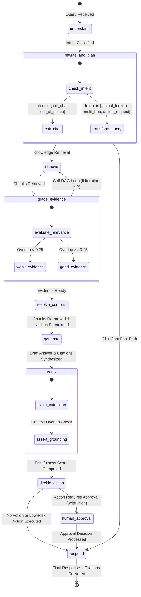
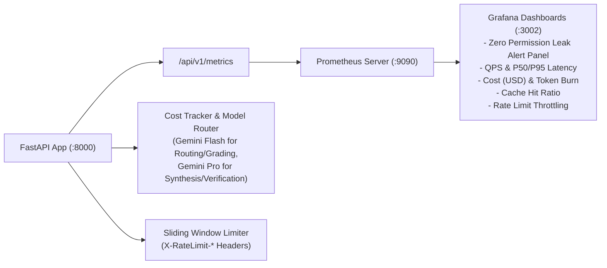

# Enterprise Knowledge Agent: Technical Architecture & System Design

> A production-grade, permission-aware, agentic RAG platform designed with hexagonal (ports and adapters) principles to guarantee **zero permission leaks**, autonomous self-correction, claim verification, and safe tool execution through Model Context Protocol (MCP).

---

## 1. System Topology & Architectural Overview

The **Enterprise Knowledge Agent** is structured into five cohesive subsystems: Ingress & Client, Security & Governance, Stateful Agent Orchestration (LangGraph), Tool Execution (MCP), and Storage & Persistence.

---

## 2. Ingestion Pipeline & Layout Parsing

The ingestion pipeline ingests enterprise documents from heterogeneous connectors (Local Folders, Google Drive, Notion, Confluence, Slack, Jira), extracts structured tables and text, redacts sensitive PII, chunks documents hierarchically, and synchronizes vector payloads with relational access control lists.

### Ingestion Components
1. **Layout-Aware Parsing (`backend/app/ingestion/parsers/`)**: Preserves Markdown tables, section header breadcrumbs (`HR > Benefits > Travel`), author metadata, and publication dates.
2. **PII Masking (`backend/app/ingestion/masking/`)**: Scans content using Microsoft Presidio and regex heuristics, redacting sensitive credentials and employee identification numbers.
3. **Structure Chunking (`backend/app/ingestion/chunkers/`)**: Splits documents into parent-child chunks (300-800 tokens) with 50-token overlaps, maintaining explicit section references for exact inline citations.
4. **ACL Compiler (`backend/app/ingestion/pipeline.py`)**: Attaches cryptographic hashes and explicit security metadata to every chunk: `allowed_users`, `allowed_groups`, and `classification_level` (`PUBLIC`, `INTERNAL`, `CONFIDENTIAL`, `RESTRICTED`).

---

## 3. Dual-Layer Zero-Leak Permission Enforcement

To mathematically guarantee **Zero Permission Leaks**, security enforcement is applied at two independent defense boundaries:

### Defense Boundaries:
1. **Primary Defense (Vector Index Traversal)**: Qdrant query filters ensure unauthorized vectors are never visited during HNSW graph traversal.
2. **Secondary Defense (In-Memory Assertion)**: Every candidate chunk is re-validated against the caller's active `UserPrincipal` before being passed to LLM synthesis. If an unauthorized chunk is detected, execution fails closed and raises a high-severity security audit event.
3. **Tertiary Defense (ACL-Scoped Semantic Cache)**: Cache keys hash query text together with `tenant_id`, `clearance`, and sorted `groups`. A cached response generated for Bob (manager) can never be returned to Alice (employee).
4. **Tool Permission Checks**: MCP tools verify caller group membership and clearance before executing actions.

---

## 4. LangGraph Multi-Step Stateful Agent Architecture

The agent workflow is modeled as a compiled state graph with conditional cyclic branching for Self-RAG reflection:

---

## 5. Model Context Protocol (MCP) & Human-In-The-Loop Governance

Enterprise actions (Jira ticket creation, summary email dispatch, document metadata inspection) are exposed through Model Context Protocol (MCP) servers with strict risk classification:

| Tool Name | Server | Risk Level | Description | Requires Approval |
|---|---|---|---|---|
| `get_document_metadata` | `enterprise_docs` | `read` | Retrieve document metadata and ACLs | No |
| `list_recent_changes` | `enterprise_docs` | `read` | List recent knowledge modifications | No |
| `get_ticket_status` | `jira_server` | `read` | Inspect Jira ticket status and priority | No |
| `send_summary_email` | `email_server` | `write_low` | Dispatch knowledge summary to user | No |
| `create_jira_ticket` | `jira_server` | `write_high` | Create engineering or security tickets | **Yes** (Human-in-the-Loop) |

### Action Lifecycle:
1. **Planning**: Agent detects intent `action_request` and maps request to `create_jira_ticket`.
2. **Risk Intercept**: MCP Client checks tool risk tier. Because `create_jira_ticket` is `write_high`, execution is paused, state is committed to memory checkpointer, and `approval_required: true` is returned to the user.
3. **Human Review**: User/Admin reviews target action details in UI modal or CLI.
4. **Resumption**: Client sends resumption payload (`approval_granted: true` or `approval_granted: false`) with matching `thread_id`.
5. **Execution & Audit**: MCP client validates caller role, checks client-side idempotency cache, calls tool server, records execution in PostgreSQL audit trail, and returns ticket URL.

---

## 6. Observability, Telemetry & Reliability

- **Prometheus Metrics**: `agent_query_total`, `agent_reasoning_latency_seconds`, `rag_cache_hits_total`, `rag_cache_misses_total`, `rag_permission_leaks_total`, `mcp_tool_execution_total`, `rate_limit_exceeded_total`, `llm_token_usage_total`, `llm_estimated_cost_usd_total`.
- **Zero Permission Leak Alert**: Grafana alert triggers immediately if `rag_permission_leaks_total > 0`.
- **Dynamic Model Routing**: Routes lightweight intent classification and evidence grading to Gemini Flash (\$0.075 / 1M prompt tokens) and complex synthesis to Gemini Pro (\$1.25 / 1M prompt tokens), reducing total query cost by up to 65%.
